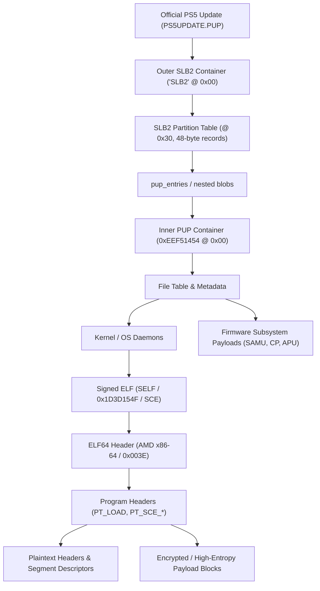
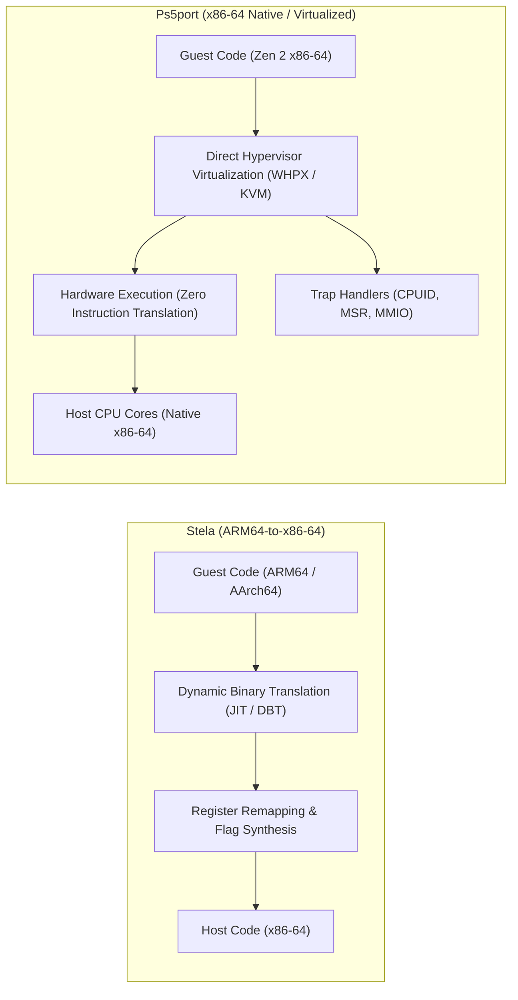

# Ps5port System & Hypervisor Architecture

This document outlines the technical architecture of `Ps5port`, detailing the container hierarchy of PlayStation 5 firmware packages, the boundary between plaintext metadata and encrypted retail segments, and the architectural differences between native x86-64 PS5 hypervisor virtualization and ARM64-to-x86-64 binary translation.

---

## 1. Container & Firmware Hierarchy

PS5 system software updates and executables are structured in a nested container hierarchy:

### 1.1 Outer SLB2 Container
- **Magic**: `b"SLB2"` (`0x53, 0x4C, 0x42, 0x32`) at offset `0x00`.
- **Header Layout**:
  - `0x00..0x03`: Magic string (`SLB2`).
  - `0x04..0x07`: Format version (little-endian `uint32`, typically `1`).
  - `0x08..0x0B`: Entry count (`uint32`).
  - `0x0C..0x0F`: Total container sector count (`uint32`, 512-byte sectors).
  - `0x10..0x2F`: Reserved padding.
- **Entry Table** (Starts at offset `0x30`, each entry is `0x30` / 48 bytes):
  - `0x00..0x03`: Start sector offset (`uint32`). Byte offset = `offset_sectors * 512`.
  - `0x04..0x07`: Size in sectors (`uint32`). Byte size = `size_sectors * 512`.
  - `0x08..0x0F`: Reserved (`uint64`).
  - `0x10..0x2F`: Filename (`[u8; 32]`, null-terminated ASCII string).

### 1.2 Inner SCE PUP Container
- **Magic**: `0xEEF51454` (Little-endian byte sequence `0x54, 0x14, 0xF5, 0xEE`).
- **Header Fields**:
  - Package type, header size, file count, segment count, and system software revision flags.
- **Inner Descriptors**:
  - File IDs representing partition tables, secure partitions, system recovery images, and firmware component archives.

### 1.3 SELF & ELF64 Executable Format
- **SELF (Sony Signed ELF)**:
  - Outer container wrapping Orbis/Prospero executable binaries.
  - Magic identifier: `0x1D3D154F` or `SCE\0`.
  - Preserves program header definitions and category metadata while protecting inner payload code.
- **Standard ELF64**:
  - Class: 64-bit (`EI_CLASS = 2`), Little-endian (`EI_DATA = 1`).
  - Machine Architecture: AMD x86-64 (`e_machine = 0x003E`).
  - Program headers (`Elf64ProgramHeader`, 56 bytes) describe:
    - `PT_LOAD (0x01)`: Loadable memory segments (`p_vaddr`, `p_paddr`, `p_filesz`, `p_memsz`, flags `PF_X`, `PF_W`, `PF_R`).
    - `PT_SCE_RELA (0x60000000)`: Proprietary relocations table.
    - `PT_SCE_DYNLIBDATA (0x61000000)`: Dynamic library linkage data and symbol metadata.
    - `PT_SCE_PROCPARAM (0x61000001)`: Process parameters and system memory quotas.

---

## 2. Plaintext vs. Encrypted Security Boundaries

A central tenet of the `Ps5port` research framework is adherence to clean-room engineering and strict legal transparency.

### 2.1 Cryptographic Separation
1. **Plaintext Metadata**:
   - Container manifests, partition tables, segment layout descriptors, virtual address mappings (`p_vaddr`), memory sizes (`p_memsz`), and permission flags (`R/W/X`) are intentionally readable in plaintext to allow system bootloaders and hypervisors to stage memory allocations.
2. **Encrypted Retail Segments**:
   - Retail payload blocks (such as encrypted `.text` code segments) are secured using hardware keys tied to the AMD Platform Security Processor (PSP) / Secure Asset Management Unit (SAMU).
   - `Ps5port` does **not** fabricate encryption keys, defeat access controls, or treat high-entropy ciphertext as executable code.

### 2.2 Shannon Entropy Classification
The `pup_inspector` utility and `loader` crate evaluate segment entropy using Shannon's equation:

$$H(X) = -\sum_{i=0}^{255} P(x_i) \log_2 P(x_i)$$

| Entropy Range (bits/byte) | Classification | Typical Content |
|---|---|---|
| $0.0 \le H < 3.5$ | `LOW_ENTROPY_SPARSE` | Zero-padded padding, sparse BSS mappings |
| $3.5 \le H < 7.1$ | `PLAINTEXT_CODE_OR_DATA` | Unpacked x86-64 machine code, ASCII/UTF strings, symbol tables |
| $7.1 \le H < 7.85$ | `STRUCTURED_OR_COMPRESSED` | Structured tables, compressed container manifests |
| $7.85 \le H \le 8.0$ | `ENCRYPTED_OR_HIGH_ENTROPY` | Encrypted retail payloads, cryptographic digests |

When `pup_inspector` or `loader` encounters high-entropy segments, it safely flags their security status without crashing or performing illegal operations.

---

## 3. System Architecture & Comparison: Native x86-64 Hypervisor vs DBT

A critical technical distinction in PS5 system emulation is the difference in execution model compared to translation-based emulators (such as Stela):

### 3.1 Why Native Execution Replaces Binary Translation
- **Stela** bridges different instruction set architectures (ISA): translating ARM64 instructions into x86-64 machine code. This incurs JIT translation latency, register allocation overhead, and condition flag synthesis penalties.
- **PS5 (Oberon APU)** runs on 8 custom AMD Zen 2 x86-64 CPU cores.
- Because host PCs run on standard x86-64 microprocessors, **no instruction translation or JIT is required**.
- Instead, `Ps5port` employs **Hypervisor Virtualization & System Call Thunking**:
  - The guest code executes directly on the physical host CPU using hardware virtualization extensions (AMD-V / Intel VT-x via WHPX or KVM).
  - Traps are confined to privileged operations: `CPUID` instruction queries, Model-Specific Register accesses (`MSR`), and Memory-Mapped I/O (`MMIO`).

### 3.2 Key Hardware Abstractions in `core/`

1. **Zen 2 "Oberon" CPUID & MSRs (`hypervisor_mmio`)**:
   - Identifies the processor as AMD Family 17h, Model 60h, Stepping 1 (Zen 2 Ariel/Oberon).
   - Manages x86-64 system call registers: `IA32_LSTAR` (kernel entry), `IA32_STAR`, `IA32_SFMASK`, and user/kernel thread pointers (`IA32_FS_BASE`, `IA32_GS_BASE`).
2. **Kraken Hardware Decompression Engine (`devices/kraken.rs`)**:
   - The PS5 hardware offloads asset streaming to a dedicated custom RAD Game Tools Kraken DMA decompressor achieving 5-9 GB/s throughput.
   - `Ps5port` models the DMA command rings and MMIO control registers to offload decompression tasks without saturating emulated Zen 2 cores.
3. **Custom NVMe Storage Controller (`devices/storage.rs`)**:
   - Models the multi-queue high-priority flash controller interfacing directly with system memory.
4. **Autonomous Graphics Engine (AGC) & RDNA 2 Translation (`graphics_agc`)**:
   - Decodes PM4 (Packet Micro-Engine 4) command streams generated by the Orbis/Prospero graphics driver.
   - Translates RDNA 2 draw packets (`IT_DRAW_INDEX_AUTO`, `IT_SET_CONTEXT_REG`, `IT_DISPATCH_DIRECT`) into Vulkan 1.3 / SPIR-V / NIR pipelines.
